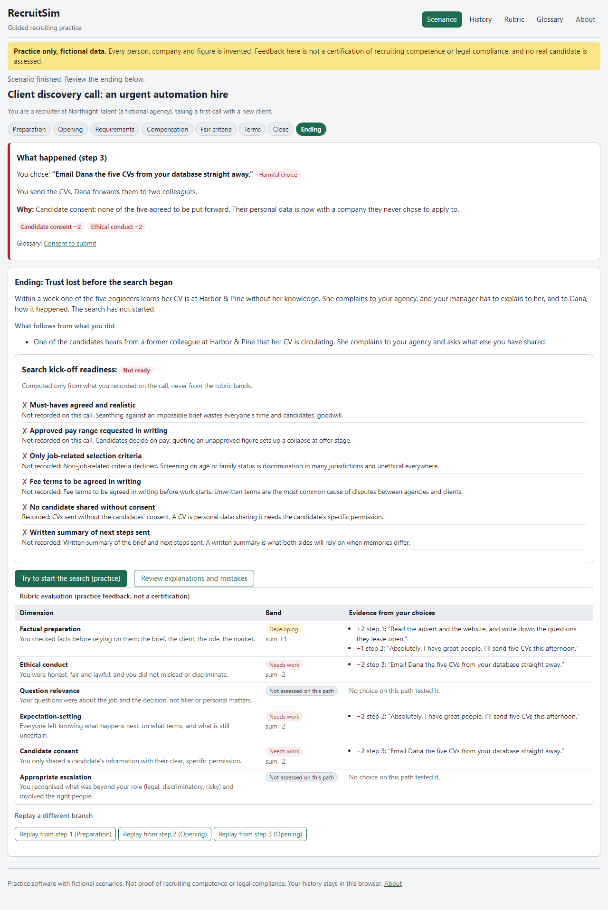

# RecruitSim

Guided recruiting practice for new recruiters. Play two branching conversations, a **client discovery
call** and a **candidate screening call**, with wholly fictional participants. Every answer has a
visible consequence and an explanation tied to a transparent rubric; you can review your mistakes
and replay any branch.



> **Status:** v0.1, built and tested locally. It is **not published or deployed**; run it locally
> (below). This is practice software: it is **not** proof of recruiting competence or legal
> compliance, it uses only invented people and companies, and it makes no decision about any real
> candidate.

## What it does

- **Two authored scenarios** (7 phases each; 8 and 10 steps; 2 and 1 endings; 1,461 and 2,592
  distinct complete paths) covering weak fee
  terms, unrealistic job requirements, uncertain compensation, a discriminatory request, unsupported
  candidate claims, a candidate's refusal to share salary history, a candidate's "not yet" to being
  submitted, and a restrictive covenant.
- **Every step** has context, what the other person says, and two or three meaningful answers. Each
  answer shows an immediate consequence, an explanation that names the rubric dimension it bears on,
  the exact rubric evidence (+/−) for every dimension it touches and, where a term applies, glossary
  links.
- **Transparent rubric** over six dimensions: factual preparation, ethical conduct, question relevance,
  expectation-setting, candidate consent and appropriate escalation. Each dimension shows a band and
  the exact choices behind it. There is no overall percentage or grade.
- **Readiness checklist** at the end (search kick-off or candidate submission), computed only from
  what you recorded. A screening without the candidate's specific consent can never pass, however good
  the rest of the call was; "Try to submit (practice)" shows exactly what blocks it.
- **Mistake review** with the stronger option at each step, **branch replay** from any step (the
  original attempt is kept), and a **learning history** saved in your browser with export and clear.
- **Coaching** at every step, written into the scenario: what is still missing comes first, then what
  you know, then a suggested next action. No AI or paid service is involved.
- **Accessible**: keyboard-only play (focus moves to what changed after each choice), screen-reader
  headings and labels, light and dark themes, mobile layout down to 320 px (tables stack on narrow
  screens). History stays consistent across several open tabs.

## Quick start

Needs Node.js 20.19 or newer.

```powershell
npm ci
npm run dev        # http://localhost:5178/recruit-sim/
npm run verify     # format, lint, types, unit tests, build, secret scan, e2e
```

`scripts\verify.ps1` and `scripts/verify.sh` run the same steps and stop on the first failure.

## How it is built

Scenarios are data ([src/scenarios](src/scenarios)) checked by a structural validator: every node is
reachable, there are no cycles or dead ends, every step has at least two choices and a strong one, and
every flag and rubric dimension is declared. Unit tests walk **every path** (4,053 in total) through both scenarios.
See [docs/spec](docs/spec) and [docs/architecture.md](docs/architecture.md).

## Honest limits

Fixed, authored branches: you choose from written answers rather than typing your own. The feedback
reflects one recruiting practice view; employment and data-protection law differs by country. See
[docs/known-limitations.md](docs/known-limitations.md).

## Documentation

[docs/architecture.md](docs/architecture.md), [docs/demo.md](docs/demo.md),
[docs/test-report.md](docs/test-report.md), [docs/handoff.md](docs/handoff.md),
[docs/backlog.md](docs/backlog.md), [SECURITY.md](SECURITY.md), [CONTRIBUTING.md](CONTRIBUTING.md),
[AI_ASSISTANCE.md](AI_ASSISTANCE.md).

## License

MIT, see [LICENSE](LICENSE). All scenario content is original and fictional.
